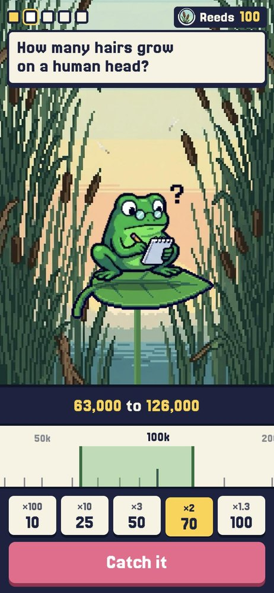

# Fermi Frog

A daily estimation game. Five questions a day, the same for everyone.
You do not type a number: you drag a scale, choose how wide your range is, and send the frog's tongue after a fly.
A narrow range that holds the answer pays more, and every point is height: the frog climbs from the pond to the moon.

**Play it: https://frog.eliott.website**

<p>
  
  
  
  
</p>

The game is named after Enrico Fermi, who liked questions such as "How many piano tuners work in Chicago?".
You cannot know the answer, but you can reason your way to the right size.

## How a round works

1. **Drag the scale.** Each step to the right is ten times more, so 1 and 1 trillion fit on one strip.
2. **Pick a width.** Five widths, from 100 times wide (10 points) to 1.3 times wide (100 points).
3. **Catch the fly.** The fly lands on the true answer. Inside your range: the frog eats it and climbs.

Each question has a one-minute stopwatch: at zero, the fly escapes. A small calculator helps with the sums, and its
result can be put on the scale with one press. Every day deals two easy questions, two medium ones and a hard one,
from a bank of 102, so no question comes back for at least 10 days.

| Height | 0 | 100 | 200 | 300 | 400 | 500 |
|---|---|---|---|---|---|---|
| Place | Pond | Reeds | Trunk | Canopy | Clouds | Moon |

After the round, you can put your score on the day's tree and see where the other frogs stopped.

## What I worked on

Front end, interface and game feel. The first version was a form with number fields, and it felt like homework.
The second version is this one: no typing, very little text, one mascot, and a world that shows the score.

- **No framework, no build step.** Plain HTML, CSS and JavaScript. Open the files and read them.
- **A scale you can use with a thumb, a mouse or a keyboard** (arrow keys, Shift for big steps, 1 to 5 for the width).
- **A profile**: eight frogs, a name, five app colours. It lives in the browser, and in an account if the player signs in.
- **Sign-in with Google, asking for almost nothing.** The game learns an account number: no email, no name. Rounds and profile then follow the player from one device to another, and a button deletes it all.
- **Three languages**: English, French and Spanish, the questions included. Each language writes numbers its own way: 2.5 billion, 2,5 milliards, 2500 millones.
- **A pond to float about in.** Once the day's round is played, the start screen becomes a pond seen from above. Hold the mouse button or a finger and the frog's lily pad drifts over, slowly; on a phone you can tilt to steer.
- **A frog that moves.** Ten short animations, made from the still poses with a video model and cut into sprite sheets by a script. Players who ask their device for less motion keep the stills.
- **A leaderboard that cannot be flattered.** The page sends the five ranges, never a score. The server works the score out itself.
- **Tests first.** The rules, the translations, the profile and the server are checked by `node --test`.

## Run it

You need [Node.js](https://nodejs.org) 20 or newer. Nothing to install.

```bash
node server.mjs
```

Then open http://localhost:8123.

```bash
node --test
```

## How the parts connect

```text
 in the browser                                            on the server
 ┌────────────────────────────────────────────────┐       ┌──────────────────────────┐
 │ boot.js     colour and language, before paint  │       │ server.mjs               │
 │ core.js     the rules: points, places, days ───┼───┐   │   serves the files       │
 │ profile.js  what a valid profile is            │   │   │   /api/scores            │
 │ i18n.js     every sentence, in three languages │   └──▶│ leaderboard.mjs          │
 │ questions.js  the question bank ───────────────┼──────▶│   scores the ranges      │
 │ world.js    the six scenes and the tree        │       │   with the same core.js  │
 │ tape.js     the scale you drag                 │  five │   one score per player   │
 │ calc.js     the calculator's sums              │       │                          │
 │ app.js      the five screens ──────────────────┼─ranges▶   per day                │
 └────────────────────────────────────────────────┘       └──────────────────────────┘
```

`core.js` and `questions.js` run on both sides. That is why the server can check a score without trusting the page.

## Online

The live game runs on Vercel. The page's files are served as they are, and `api/scores.mjs` takes the place of
`server.mjs`: the same `leaderboard.mjs`, with the scores in Vercel Blob (a private file store) instead of a file
on one computer. There is one small file per day. When two players post in the same instant, the second write
notices that the file changed, reads it again and retries, so no score is lost.

```bash
npx vercel deploy --prod --yes
```

`.vercelignore` lists what stays on this computer: saved scores, keys, tests and the art's working files.

## Accounts

Signing in is free and never required. It does one thing: the frog, the settings and the rounds are kept in an
account as well as in the browser, so they are there on the next device.

```text
 the profile screen                      the server (account.mjs)                    Google
 ┌────────────────────┐  1 press        ┌───────────────────────────┐  2 "who is    ┌──────────────────┐
 │ Sign in with Google├────────────────▶│ /api/auth/google          ├──this?"──────▶│ "Continue as…?"  │
 └────────────────────┘                 │ /api/auth/callback        │◀─3 a one-time─┤                  │
 ┌────────────────────┐  5 a cookie     │   4 swaps the code for an │    code       └──────────────────┘
 │ the game, signed in│◀────────────────┤     account number        │
 │                    │  6 save / load  │ /api/me                   │      one small private file per account:
 │ app.js             │◀───────────────▶│   merges the two copies   │───▶  profile, rounds, plan
 └────────────────────┘                 └───────────────────────────┘
```

Two copies of a player (a device and the account) are merged by rules written in `profile.js`: a day keeps the copy
that got further, so no round is ever lost, and the profile changed last wins. The page can never set its own `plan`:
only the server can, which is what the supporter plan rests on (below).

Online, sign-in is switched on: the three keys below are set in the Vercel project. Anywhere they are missing
(a new copy of the game, or this computer without `.env.local`), sign-in stays off. To set it up:

1. In the [Google Cloud console](https://console.cloud.google.com/apis/credentials), create an **OAuth client ID**
   of type "Web application". Give it two **authorised redirect URIs**:
   `https://frog.eliott.website/api/auth/callback` and `http://localhost:8123/api/auth/callback`.
   Google keeps a new app in "Testing", where only the people you list can sign in: publish it (Audience, "In production")
   before telling players. The game asks for the `openid` scope only.
   On the consent screen (Branding), the home page is `https://frog.eliott.website` and the privacy policy is
   `https://frog.eliott.website/privacy.html` (the page `privacy.html`, which says what the game keeps).
2. Put the three keys in `.env.local` (never committed) to try it on this computer:

   ```text
   GOOGLE_CLIENT_ID=…the client ID Google shows…
   GOOGLE_CLIENT_SECRET=…the client secret Google shows…
   SESSION_SECRET=…any long random text, for example from: openssl rand -base64 32
   ```

3. Add the same three keys to the Vercel project (Settings, Environment Variables), then deploy.

Without the keys the game works as before, and the profile says that sign-in comes later.

## The supporter plan

One payment of 4 euros, kept for good. The daily round and the tree stay free. The card is typed on Stripe's own
page, never in the game: the game sees no card and no email.

What a supporter gets:

| Extra | Where | Who checks it |
|---|---|---|
| Play any past day | Home, "Past days": like practice, nothing saved or posted | the page |
| Stats on your guesses | Profile: caught, too high, too low, points per fly | the page |
| A golden fly by the name | the leaderboard | the server: it reads the account, never what the page says |
| Miss a day, keep the streak | one missed day a week is bridged (core.js) | the page |
| Eight more frogs | Profile; on the leaderboard only for supporters | the server, for the leaderboard |
| The pond in every season, and at night | Profile, "The pond" | the page |

What other players see (the golden fly, a supporter frog on the board) is decided by the server, so it cannot be faked.
What only the player sees (their own scenes, stats, past days) is simply locked in the page: getting around it would
change nothing for anyone else.

```text
 the plan screen ── 1 press ──▶ /api/buy ── 2 "open a payment page for account no. 1234" ──▶ Stripe
        ▲                                                                                      │
        └───────────── 3 the player pays on Stripe's page, then is sent back ◀─────────────────┘

 the game ── 4 loads the account ──▶ /api/me ── 5 "what became of that page?" ──────────────▶ Stripe
 "Thank you!" ◀── plan: supporter ─────┘ ◀──────── "paid, 4.00 EUR, for account no. 1234" ─────┘
```

The game does not wait for Stripe to call it. Each time a signed-in account is read, the server asks Stripe what
became of the payment page it opened, so a player who pays and closes the tab is still a supporter the next time.
A payment counts only if it is for this account, at the right price, and in real money. Two changes to an account
that reach the server in the same instant never erase each other, the "paid" mark least of all.

To put the plan on sale, one more key (sign-in must be on, since the plan is kept in the account):

1. Create a [Stripe](https://stripe.com) account. Selling needs a legal status (in France, for example
   micro-entrepreneur): check that before taking real money.
2. Try it at home first, with Stripe's **test** secret key in `.env.local`:

   ```text
   STRIPE_SECRET_KEY=sk_test_…
   ```

   Pay with Stripe's test card (4242 4242 4242 4242, any future date, any code). A test key sells on this
   computer only: online it sells nothing, so play money can never buy the real plan.
3. To sell for real, add the **live** key (`sk_live_…`) to the Vercel project, then deploy.

Without the key, the door to the plan is not shown at all.

## The pictures

All the art is pixel art generated with Gemini from my prompts, then cut and prepared by two small scripts.
The originals, the scripts and the way to ask for more are in [`design/`](design/PROMPTS.md).
The plan for animations is in [`design/ANIMATIONS.md`](design/ANIMATIONS.md).
The code was written with Claude Code.

## Not done yet

- The answers to the questions still need a second check against their sources.
- The supporter plan and its extras are built and tested (against a stand-in for Stripe), but it is not on sale yet:
  it needs a legal status for selling and the live Stripe key.
- Names on the leaderboard are not moderated: anyone can type any 16 characters.
- More movement: the frog moves, but the scenes and the climb from one place to the next do not yet.
