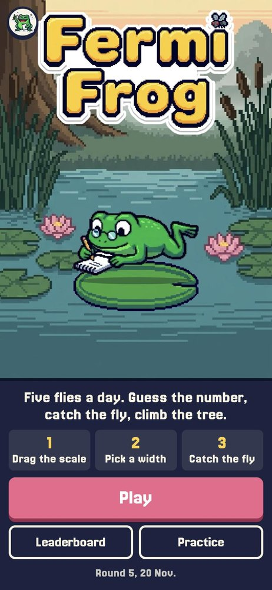
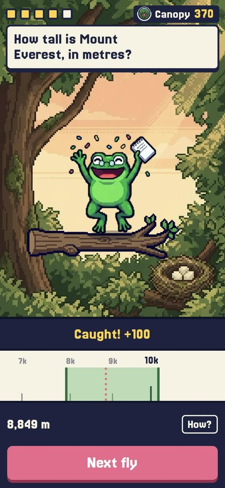
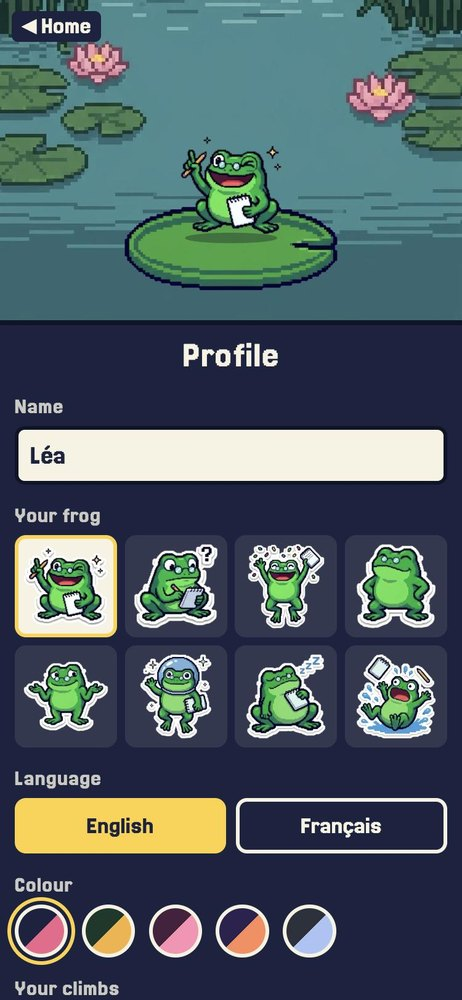

# Fermi Frog

A daily estimation game. Five questions a day, the same for everyone.
You do not type a number: you drag a scale, choose how wide your range is, and send the frog's tongue after a fly.
A narrow range that holds the answer pays more, and every point is height: the frog climbs from the pond to the moon.

<p>
  
  
  
  
</p>

The game is named after Enrico Fermi, who liked questions such as "How many piano tuners work in Chicago?".
You cannot know the answer, but you can reason your way to the right size.

## How a round works

1. **Drag the scale.** Each step to the right is ten times more, so 1 and 1 trillion fit on one strip.
2. **Pick a width.** Five widths, from 100 times wide (10 points) to 1.3 times wide (100 points).
3. **Catch the fly.** The fly lands on the true answer. Inside your range: the frog eats it and climbs.

| Height | 0 | 100 | 200 | 300 | 400 | 500 |
|---|---|---|---|---|---|---|
| Place | Pond | Reeds | Trunk | Canopy | Clouds | Moon |

After the round, you can put your score on the day's tree and see where the other frogs stopped.

## What I worked on

Front end, interface and game feel. The first version was a form with number fields, and it felt like homework.
The second version is this one: no typing, very little text, one mascot, and a world that shows the score.

- **No framework, no build step.** Plain HTML, CSS and JavaScript. Open the files and read them.
- **A scale you can use with a thumb, a mouse or a keyboard** (arrow keys, Shift for big steps, 1 to 5 for the width).
- **A profile**: eight frogs, a name, English or French, five app colours. It lives in the browser for now.
- **A leaderboard that cannot be flattered.** The page sends the five ranges, never a score. The server works the score out itself.
- **Tests first.** The rules, the translations, the profile and the server are checked by `node --test`.

## Run it

You need [Node.js](https://nodejs.org) 20 or newer. Nothing to install.

```bash
node server.mjs
```

Then open http://localhost:8123.

```bash
node --test
```

## How the parts connect

```text
 in the browser                                            on the server
 ┌────────────────────────────────────────────────┐       ┌──────────────────────────┐
 │ boot.js     colour and language, before paint  │       │ server.mjs               │
 │ core.js     the rules: points, places, days ───┼───┐   │   serves the files       │
 │ profile.js  what a valid profile is            │   │   │   /api/scores            │
 │ i18n.js     every sentence, English and French │   └──▶│ leaderboard.mjs          │
 │ questions.js  the question bank ───────────────┼──────▶│   scores the ranges      │
 │ world.js    the six scenes and the tree        │       │   with the same core.js  │
 │ tape.js     the scale you drag                 │  five │   one score per player   │
 │ app.js      the five screens ──────────────────┼─ranges▶   per day                │
 └────────────────────────────────────────────────┘       └──────────────────────────┘
```

`core.js` and `questions.js` run on both sides. That is why the server can check a score without trusting the page.

## The pictures

All the art is pixel art generated with Gemini from my prompts, then cut and prepared by two small scripts.
The originals, the scripts and the way to ask for more are in [`design/`](design/PROMPTS.md).
The plan for animations is in [`design/ANIMATIONS.md`](design/ANIMATIONS.md).
The code was written with Claude Code.

## Not done yet

- The game is not online yet.
- The questions are in English only, and their answers still need a second check against their sources.
- Sign-in with Google, so a profile follows its player from one device to another.
- Animations: today the frog changes pose, it does not move.
